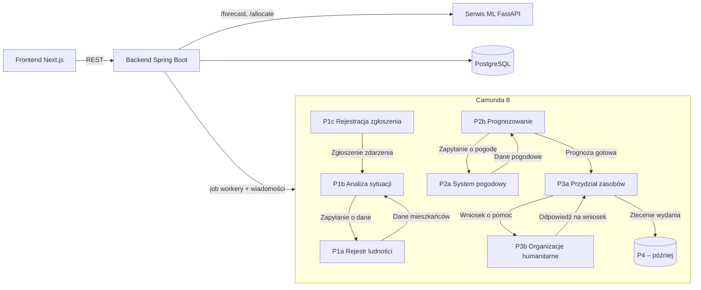

# Plan realizacji etapu III – implementacja procesów, reguł i algorytmów AI/ML

> Dokument dla obu autorów. Czytamy go przed rozpoczęciem każdego kroku i odhaczamy zadania `[x]`.
> Zakres: **P1, P2, P3** (zatwierdzone przez prowadzącego). P4 i P5 – dopiero po akceptacji.

**Podział pracy** – każda rzecz ma jednego właściciela, nie ma zadań „wspólnych”.

| | **Ilia** | **Robert** |
|---|---|---|
| Część systemu | **backend** (Spring Boot) + **Camunda** + baza danych | **ml-service** (Python) + **cały frontend** (Next.js) |
| Procesy | **P1** (P1a, P1b, P1c) i **P3** (P3a, P3b) – BPMN wykonywalne, workery, formularze | **P2** (P2a, P2b) – BPMN wykonywalne, workery, formularz |
| Reguły / algorytmy | DMN `Priorytet_mieszkancow` | model ML (`/forecast`), algorytm LP (`/allocate`), dane syntetyczne |
| API | REST backendu `/api/...` (sekcja 8) – Robert z niego korzysta we frontendzie | API serwisu ML (sekcja 8) – Ilia z niego korzysta w workerze P3 |
| Testy | JUnit + Mockito, testy procesów P1 i P3 | pytest (ML, LP), testy procesu P2 |
| Dokumentacja rozdz. 3 | architektura, Camunda, DMN, API backendu | model ML, algorytm LP, frontend |

Kto jest właścicielem API, ten opisuje je w sekcji 8 jako pierwszy i nie zmienia go bez uprzedzenia drugiej osoby.
Każdy pracuje na swojej gałęzi (`ilia/...`, `robert/...`) i robi Pull Request do `main`; drugi autor tylko przegląda PR (żeby rozumieć cały kod na obronie).

---

## 1. Jak to działa – obraz całości (do zrozumienia przed startem)



**Słowniczek (to pytania z obrony):**

- **Job worker** – metoda w Javie z adnotacją `@JobWorker(type = "…")`. Camunda, dochodząc do service/send taska, tworzy „job” o danym typie; worker go pobiera, wykonuje kod i odsyła wynik (zmienne procesu).
- **Wiadomość (message)** – sposób komunikacji między procesami. Worker „publikuje” wiadomość o nazwie np. „Prognoza gotowa”; Camunda dostarcza ją do procesu, który na nią czeka (start event albo receive task).
- **Correlation key** – „numer sprawy”, po którym Camunda wie, *do której* instancji procesu dostarczyć wiadomość. Np. P1b wysyła zapytanie z `idZapytania = 123`, a odpowiedź z P1a też niesie `123` → trafia do właściwej instancji.
- **TTL wiadomości** – jak długo Camunda przechowuje wiadomość, jeśli odbiorca jeszcze nie czeka (np. P1a odpowie szybciej, niż P1b dojdzie do receive taska). Ustawiamy `PT1H`.
- **DMN** – tabela decyzyjna (reguły biznesowe) wdrażana do Camundy. Zmiana reguły = zmiana tabeli, bez zmiany kodu.
- **User task** – zadanie dla człowieka; obsługujemy je w **Camunda Tasklist** z formularzem (`.form`).

---

## 2. Zasada nr 1: nie zmieniamy modeli

Modele P1–P3 są zatwierdzone. W wersjach wykonywalnych dodajemy **tylko ustawienia techniczne** (job type, nazwy wiadomości, correlation key, warunki na bramkach, formularze). Rzeczy, które są w opisie procesu, a nie ma ich na diagramie, robimy **w kodzie backendu**, nie na diagramie:

| Z opisu procesu | Jak realizujemy bez zmiany modelu |
|---|---|
| DMN „Wyznacz potrzeby i priorytet” musi działać dla **każdego** mieszkańca | Business rule task dostaje implementację *job worker* (`wyznacz-potrzeby-i-priorytet`). Worker w pętli wywołuje wdrożoną tabelę DMN przez API Camundy dla każdego mieszkańca. Diagram bez zmian, a DMN dalej jest w Camundzie (widać ją w Operate). |
| „Analityk nie zweryfikuje prognozy w 1 h → prognoza przyjęta automatycznie” (P2) | *(jeśli zostanie czas)* Backend co minutę sprawdza otwarte user taski; po 1 h sam je kończy ze zmienną `autoZatwierdzono = true` i wpisem do audytu. |
| „Plan niezatwierdzony w 2 h → zatwierdzony automatycznie” (P3) | jw., po 2 h. |
| „Model ML niedostępny → ostatnia zatwierdzona prognoza” (P2) | `try/catch` w workerze `wykonaj-prognoze-ml`. |
| Start P2 „Zmiana sytuacji kryzysowej” i P3 „Ponowne planowanie” (przychodzą z P5, którego jeszcze nie ma) | Przycisk „Symulacja” we frontendzie → backend publikuje wiadomość. |
| Timer `R/PT12H` pierwszy raz odpali się dopiero 12 h po wdrożeniu | Na demo uruchamiamy procesy wiadomością (zgłoszenie / symulacja). |

---

## 3. Rozdzielenie P2 i P3 na osobne procesy (jak P1)

Wzór: P1 jest już podzielony na `P1a`, `P1b`, `P1c`. Każdy pool = osobny plik = osobny proces.

| Plik w `bpmn/wykonywalne/` | Process ID | Z którego poola modelu |
|---|---|---|
| `P2a_System_pogodowy.bpmn` | `Proces_System_pogodowy` | „System pogodowy” |
| `P2b_Prognozowanie_zapotrzebowania.bpmn` | `Proces_Prognozowanie` | „Centrum kryzysowe – Prognozowanie zapotrzebowania” |
| `P3a_Przydzial_zasobow.bpmn` | `Proces_Przydzial` | „Centrum kryzysowe – (Przydział zasobów)” |
| `P3b_Organizacje_humanitarne.bpmn` | `Proces_Organizacje_humanitarne` | „Organizacje humanitarne” |

Elementy, nazwy, bramki i przepływy – **1:1 z modelu**. Dodajemy tylko to, co w tabelach poniżej.

---

## 4. Job type, wiadomości, correlation key

### 4.1. Job type (jeden worker = jeden typ)

| Proces | Element (nazwa z modelu) | Job type | Co robi worker | Kto |
|---|---|---|---|---|
| P1b | Wyślij zapytanie o dane mieszkańców | `wyslij-zapytanie-o-dane` | tworzy `idZapytania`, publikuje „Zapytanie o dane” | Ilia |
| P1a | Odczytaj dane mieszkańców z ewidencji | `odczytaj-dane-mieszkancow` | czyta tabelę `ewidencja_ludnosci` | Ilia |
| P1a | Dane wysłane (message end) | `wyslij-dane-mieszkancow` | publikuje „Dane mieszkańców” (+ lista mieszkańców) | Ilia |
| P1b | Wyznacz potrzeby i priorytet (DMN) | `wyznacz-potrzeby-i-priorytet` | dla każdego mieszkańca wywołuje DMN | Ilia |
| P1b | Zapisz wyniki w rejestrze potrzeb | `zapisz-wyniki` | zapis priorytetów/potrzeb + audyt | Ilia |
| P1c | Przekaż zgłoszenie do centrum | `przekaz-zgloszenie` | publikuje „Zgłoszenie zdarzenia”, losuje kontrolę (20%) | Ilia |
| P2b | Wyślij zapytanie o dane pogodowe | `wyslij-zapytanie-o-pogode` | tworzy `idZapytaniaPogody`, publikuje | Robert |
| P2a | Pobierz prognozę pogody | `pobierz-prognoze-pogody` | symulacja pogody (sezon + losowość) | Robert |
| P2a | Dane pogodowe wysłane (message end) | `wyslij-dane-pogodowe` | publikuje „Dane pogodowe” | Robert |
| P2b | Wykonaj prognozę zapotrzebowania (model ML) | `wykonaj-prognoze-ml` | `POST /forecast`, zapis prognozy, liczy `roznicaProcent` | Robert |
| P2b | Prognoza gotowa (message end) | `wyslij-prognoze-gotowa` | publikuje „Prognoza gotowa” | Robert |
| P3a | Pobierz stany magazynowe, potrzeby i prognozy | `pobierz-dane-do-przydzialu` | magazyn + wyniki P1 + prognoza P2 | Ilia |
| P3a | Wygeneruj plan przydziału (algorytm optymalizacyjny) | `wygeneruj-plan-przydzialu` | `POST /allocate`, zapis planu, `potrzebyKrytycznePokryte` | Ilia |
| P3a | Wyślij wniosek o pomoc humanitarną | `wyslij-wniosek-o-pomoc` | tworzy `idWniosku`, publikuje „Wniosek o pomoc” | Ilia |
| P3b | Odpowiedź wysłana (message end) | `wyslij-odpowiedz-na-wniosek` | publikuje „Odpowiedź na wniosek” | Ilia |
| P3a | Wyślij zlecenia wydania do magazynu | `wyslij-zlecenia-wydania` | zapis zleceń w bazie + wiadomość „Zlecenie wydania” (dla przyszłego P4) | Ilia |

### 4.2. Wiadomości

| Nazwa wiadomości | Od → do | Element odbierający | Correlation key |
|---|---|---|---|
| Zgłoszenie zdarzenia | P1c → P1b | start event | `=idZgloszenia` |
| Zapytanie o dane | P1b → P1a | start event | `=idZapytania` |
| Dane mieszkańców | P1a → P1b | receive task „Odbierz dane mieszkańców” | `=idZapytania` |
| Zapytanie o pogodę | P2b → P2a | start event | `=idZapytaniaPogody` |
| Dane pogodowe | P2a → P2b | receive task „Odbierz dane pogodowe” | `=idZapytaniaPogody` |
| Zmiana sytuacji kryzysowej | symulacja (P5) → P2b | start event | `=idZdarzenia` |
| Prognoza gotowa | P2b → P3a | start event | `=idPrognozy` |
| Ponowne planowanie | symulacja (P5) → P3a | start event | `=idZdarzenia` |
| Wniosek o pomoc | P3a → P3b | start event | `=idWniosku` |
| Odpowiedź na wniosek | P3b → P3a | receive task „Odbierz odpowiedź na wniosek” | `=idWniosku` |
| Zlecenie wydania | P3a → (P4) | — (P4 jeszcze nie istnieje) | `=idPlanu` |

### 4.3. Warunki na bramkach (FEEL)

| Proces | Bramka | „tak” | domyślnie |
|---|---|---|---|
| P1b | Są zgłoszenia do weryfikacji? | `=zgloszenie != null and (list contains(["SMIERC","ZAGINIECIE"], zgloszenie.rodzaj) or zgloszenie.losowaKontrola)` | „nie” |
| P2b | Różnica względem poprzedniej > 30%? | `=roznicaProcent > 30` | „nie” |
| P3a | Potrzeby krytyczne pokryte? | `=potrzebyKrytycznePokryte` | „nie” → wniosek |

(Śmierć i zaginięcie zarząd weryfikuje **zawsze**, inne zgłoszenia – losowo, zgodnie z opisem P1.)

### 4.4. User taski i formularze (Camunda Forms, folder `bpmn/wykonywalne/forms/`)

| Proces | User task | Formularz – pola | Kto obsługuje |
|---|---|---|---|
| P1c | Zarejestruj zgłoszenie | **obsługuje nasz frontend** (formularz operatora kończy to zadanie przez API) | operator |
| P1b | Zweryfikuj zgłoszenia | dane zgłoszenia (tylko odczyt), `decyzja`: POTWIERDZONE / ODRZUCONE, `komentarz` | zarząd (Tasklist) |
| P2b | Zweryfikuj prognozę | stara vs nowa prognoza, `zatwierdzono`, `komentarz` | analityk (Tasklist) |
| P3a | Zatwierdź plan przydziału | podsumowanie planu, `zatwierdzono`, `komentarz` | analityk (Tasklist) |
| P3b | Rozpatrz wniosek i przygotuj dostawę | wnioskowane ilości, `przyznanoIlosci`, `termin` | „organizacja” (na demo – my w Tasklist) |

---

## 5. Tabele DMN

Plik `dmn/Priorytet_mieszkancow.dmn` – dwie tabele (DRD), co odpowiada nazwie zadania „Wyznacz **potrzeby i priorytet**”.

### Tabela 1 – `Priorytet` (hit policy **FIRST** – pierwsza pasująca reguła od góry)

| Wejście | Typ | Wartości |
|---|---|---|
| `status` | string | ZYJE / NIE_ZYJE / ZAGINIONY |
| `wiek` | number | lata |
| `stanZdrowia` | string | DOBRY / CHOROBA / CIEZKI |
| `chorobyPrzewlekle` | boolean | |
| `niepelnosprawnosc` | string | BRAK / LEKKI / UMIARKOWANY / ZNACZNY |
| `utrataMieszkania` | boolean | |
| `zawodKrytyczny` | boolean | lekarz, ratownik, strażak, energetyk… |
| `osobyNaUtrzymaniu` | number | |

| Wyjście | Wartości |
|---|---|
| `priorytet` | A / B / C / WYKLUCZONY |
| `poziomPotrzeb` | PODSTAWOWY / PODWYZSZONY / KRYTYCZNY |
| `dostawaBezposrednia` | true / false |

Przykładowe reguły (od góry):

| # | Warunek | priorytet | poziomPotrzeb | dostawa |
|---|---|---|---|---|
| 1 | status ≠ ZYJE | WYKLUCZONY | – | false |
| 2 | stanZdrowia = CIEZKI lub niepelnosprawnosc = ZNACZNY | A | KRYTYCZNY | true |
| 3 | wiek < 3 lub wiek ≥ 75 | A | PODWYZSZONY | wiek ≥ 75 |
| 4 | utrataMieszkania | A | PODWYZSZONY | false |
| 5 | stanZdrowia = CHOROBA lub chorobyPrzewlekle lub niepelnosprawnosc = UMIARKOWANY | B | PODWYZSZONY | false |
| 6 | zawodKrytyczny lub osobyNaUtrzymaniu ≥ 2 | B | PODSTAWOWY | false |
| 7 | (pozostali) | C | PODSTAWOWY | false |

### Tabela 2 – `Normy_dzienne` (hit policy **UNIQUE**)

Wejścia: `poziomPotrzeb`, `grupaWiekowa` (DZIECKO / DOROSLY / SENIOR).
Wyjścia (na osobę na dobę): `wodaL`, `zywnoscKg`, `lekiZestaw`, `higienaZestaw`, `schronienie` (miejsca).
Np. PODSTAWOWY + DOROSLY → woda 3 l, żywność 0,6 kg, higiena 0,1 zestawu.

**P5 – `Poziom_zagrozenia.dmn`** – dopiero po akceptacji modelu P5.

Testy DMN: w teście procesu sprawdzamy kilka przypadków (np. 80-latek → A + dostawa bezpośrednia).

---

## 6. Dane syntetyczne i model ML (Robert)

### 6.1. Dane (`ml-service/scripts/generate_data.py`, stałe ziarno `seed=42` → zawsze te same dane)

| Plik w `data/` | Zawartość | Ile |
|---|---|---|
| `dzielnice.csv`, `punkty_wydawania.csv` | 4 dzielnice, 4 punkty wydawania (przepustowość transportu w kg) | 4 + 4 |
| `budynki.csv` | id, adres, dzielnica, punkt wydawania | ~40 |
| `ewidencja_ludnosci.csv` | PESEL (syntetyczny, poprawna suma kontrolna), imię, nazwisko, płeć, wiek, zawód, budynek, gospodarstwo, stan zdrowia, choroby, niepełnosprawność, status | ~1500 |
| `stany_magazynowe.csv` | ZYWNOSC (kg), WODA (l), LEKI (zestaw), HIGIENA (zestaw), SCHRONIENIE (miejsca) | 5 |
| `historia_zuzycia.csv` | dzień × dzielnica × zasób: zużycie + cechy | 365 dni × 4 × 5 |

Cechy w historii: dzień tygodnia, miesiąc, temperatura, opady, liczba mieszkańców, % seniorów, % chorych, poziom zagrożenia (0–3), liczba alarmów w 24 h, liczba przesiedlonych.
Zużycie = znany wzór (np. woda rośnie z temperaturą, leki z % chorych, wszystko z poziomem zagrożenia) + szum losowy. Dzięki temu wiemy, czego model powinien się nauczyć.

### 6.2. Model

- **`RandomForestRegressor`** (scikit-learn) – osobny model dla każdego z 5 zasobów, w `Pipeline` z one-hot dla cech kategorycznych.
  Dlaczego: dobrze łapie zależności nieliniowe (np. upał → więcej wody), nie wymaga skalowania, daje **ważność cech** (łatwo wyjaśnić na obronie).
- Porównanie (do rozdziału 4): baseline „średnia z 7 dni” i `LinearRegression`.
- Podział: ostatnie 60 dni = test (podział czasowy, nie losowy). Metryki: **MAE, MAPE, R²**.
- Trening: `python -m app.train` → pliki `ml-service/models/*.joblib` + `metrics.json`. W Dockerze model trenuje się przy budowaniu obrazu.

### 6.3. Wynik prognozy (3 poziomy, jak w opisie P2)

- **dzielnica** – wynik modelu,
- **budynek** – prognoza dzielnicy rozdzielona proporcjonalnie do norm DMN mieszkańców budynku,
- **miasto** – suma dzielnic.

`roznicaProcent` = największa zmiana względem poprzedniej zatwierdzonej prognozy (po zasobach, na poziomie miasta).

---

## 7. Algorytm przydziału (P3) – rekomendacja: programowanie liniowe (Robert – `/allocate` w ml-service; Ilia – worker P3, który go wywołuje)

### Dlaczego tak

Mamy dwie sensowne opcje:

| | Algorytm zachłanny (priorytetowy) | **Programowanie liniowe (LP)** ✅ |
|---|---|---|
| Idea | sortuj wg priorytetu A→B→C, dawaj, aż się skończy | matematycznie znajdź najlepszy podział przy ograniczeniach |
| Kod | ~20 linii | ~40 linii (`scipy.optimize.linprog`) |
| Ograniczenia (transport, rezerwa) | trudno dodać | dopisujemy jako kolejne nierówności |
| Sprawiedliwość | pierwsze budynki z listy biorą wszystko | wbudowana (pokrycie w %, nie w kg) |
| Pasuje do nazwy zadania „algorytm **optymalizacyjny**” | słabo | tak |

**Decyzja: LP jako algorytm w procesie, a algorytm zachłanny jako punkt odniesienia w testach** (rozdział 4: „LP pokrywa X% potrzeb krytycznych przy tych samych zasobach, zachłanny Y%”).

### Jak to działa – prostymi słowami

Dla każdego budynku *b*, zasobu *r* i grupy priorytetu *p* (A/B/C) szukamy liczby **x** = ile przydzielić.

- **Cel:** maksymalizuj Σ waga(p) · x / potrzeba, gdzie waga A = 100, B = 10, C = 1.
  (Dzielimy przez potrzebę, żeby liczył się **procent pokrycia** – duży budynek nie „zjada” wszystkiego.)
- **Ograniczenia:**
  1. `0 ≤ x ≤ potrzeba[b,r,p]` – nie dajemy więcej, niż ktoś potrzebuje,
  2. Σ x dla zasobu r ≤ `stan magazynowy[r] − rezerwa[r]` – rezerwa = 10% prognozowanych potrzeb grupy A na następny cykl (**tu wykorzystujemy prognozę z P2**),
  3. Σ (x · waga_kg) dla punktu wydawania ≤ przepustowość transportu tego punktu.

**Przykład:** 100 l wody, budynek 1 potrzebuje 60 l (A), budynek 2 – 80 l (C). LP da 60 l budynkowi 1 (A ma wagę 100), resztę 40 l budynkowi 2.

### Wynik `/allocate`

- plan: budynek × zasób → przydzielono / potrzeba / % pokrycia,
- `potrzebyKrytycznePokryte` = czy każda potrzeba grupy A pokryta w 100%,
- niedobory → ilości do „Wniosku o pomoc”,
- lista dostaw bezpośrednich (mieszkańcy z `dostawaBezposrednia = true` i statusem ZYJE),
- harmonogram: budynki w okna 2-godzinne w punktach wydawania, najpierw priorytet A.

---

## 8. Kontrakty API (opisane na początku – potem każdy pracuje niezależnie)

### Serwis ML (port 8000) – właściciel: Robert

| Metoda | Ścieżka | Wejście | Wyjście |
|---|---|---|---|
| GET | `/health` | – | `{status}` |
| POST | `/forecast` | `{pogoda:{temperatura, opady}, poziomZagrozenia, dzielnice:[{id, liczbaMieszkancow, procentSeniorow, procentChorych, przesiedleni}], budynki:[{id, dzielnicaId, wagaPotrzeb}]}` | `{dzielnice:[{id, zasob, ilosc}], budynki:[…], miasto:[{zasob, ilosc}], model:"random-forest-v1"}` |
| POST | `/allocate` | `{stany:[{zasob, ilosc}], potrzeby:[{budynekId, zasob, priorytet, ilosc}], prognozaA:[{zasob, ilosc}], punkty:[{id, przepustowoscKg, budynki:[…]}]}` | `{pozycje:[{budynekId, zasob, priorytet, przydzielono, potrzeba}], potrzebyKrytycznePokryte, niedobory:[{zasob, ilosc}], harmonogram:[…]}` |
| GET | `/model/info` | – | metryki MAE/MAPE/R², data treningu |

### Backend (port 8081, prefiks `/api`) – właściciel: Ilia

| Metoda | Ścieżka | Do czego | Ekran |
|---|---|---|---|
| POST | `/api/zgloszenia` | zgłoszenie od operatora → start P1c + zakończenie „Zarejestruj zgłoszenie” | Operator |
| GET | `/api/zgloszenia` | lista zgłoszeń ze statusem | Operator |
| GET | `/api/budynki?dzielnica=` | budynki + priorytet budynku | Budynki |
| GET | `/api/budynki/{id}` | budynek + mieszkańcy | Budynki |
| GET | `/api/mieszkancy?priorytet=&status=` | lista mieszkańców | Budynki |
| GET | `/api/prognozy/ostatnia` | ostatnia prognoza (3 poziomy) | Prognoza |
| GET | `/api/prognozy` | historia prognoz | Prognoza |
| GET | `/api/zuzycie/historia?dzielnica=&zasob=` | dane historyczne do wykresu | Prognoza |
| GET | `/api/plany/ostatni`, `/api/plany/{id}` | plan przydziału, niedobory, dostawy, harmonogram | Plan |
| GET / PUT | `/api/magazyn` | stany magazynowe (PUT – zmiana na demo) | Magazyn |
| GET | `/api/procesy` | instancje procesów z Camundy | Procesy |
| POST | `/api/symulacja/zmiana-sytuacji` | publikuje „Zmiana sytuacji kryzysowej” (zamiast P5) | Procesy |
| POST | `/api/symulacja/ponowne-planowanie` | publikuje „Ponowne planowanie” (zamiast P5) | Procesy |
| GET | `/api/audyt` | dziennik decyzji | Audyt |

### Format JSON backendu – kontrakt dla frontendu (Ilia → Robert)

Wspólne zasady: JSON w UTF-8, nazwy pól po polsku w `camelCase`, daty/czasy w ISO-8601 (`2026-11-18T12:00:00Z`),
kody słownikowe jak w bazie (`A/B/C`, `ZYJE`, `WODA`…), ilości jako liczby. Błąd: HTTP 4xx/5xx i `{"blad": "opis po polsku"}`.
CORS dla `http://localhost:3000` włączony. Pola oznaczone `?` mogą być `null`.

**`POST /api/zgloszenia`** – wejście → `201`:
```json
{ "pesel": "50010112345", "budynekId": null, "rodzaj": "SMIERC", "opis": "zgłoszone przez sąsiada" }
```
(wymagany `pesel` **albo** `budynekId`; `rodzaj` ∈ CHOROBA, NIEPELNOSPRAWNOSC, UTRATA_MIESZKANIA, SMIERC, ZAGINIECIE)
```json
{ "id": 12, "status": "NOWE", "utworzono": "2026-11-18T12:00:00Z" }
```

**`GET /api/zgloszenia`** → `[ { "id": 12, "pesel": "…"?, "budynekId": 3?, "rodzaj": "SMIERC", "opis": "…"?, "losowaKontrola": false, "decyzja": "POTWIERDZONE"?, "status": "NOWE", "utworzono": "…" } ]`

**`GET /api/budynki?dzielnica=1`** → `[ { "id": 3, "adres": "Rynek 1", "dzielnicaId": 1, "dzielnica": "Centrum", "priorytet": "A"?, "liczbaMieszkancow": 24 } ]`
(`priorytet` budynku = najwyższy priorytet mieszkańca w budynku; `null`, dopóki P1 nie przeliczył)

**`GET /api/budynki/{id}`** → `{ "id": 3, "adres": "…", "dzielnicaId": 1, "dzielnica": "Centrum", "mieszkancy": [ <mieszkaniec> ] }`

**`GET /api/mieszkancy?priorytet=A&status=ZYJE`** → `[ <mieszkaniec> ]`, gdzie
`<mieszkaniec>` = `{ "pesel": "…", "imie": "Anna", "nazwisko": "Nowak", "wiek": 76, "budynekId": 3, "priorytet": "A"?, "poziomPotrzeb": "PODWYZSZONY"?, "dostawaBezposrednia": true, "status": "ZYJE" }`

**`GET /api/prognozy/ostatnia`** (M3) → `{ "id": 5, "utworzono": "…", "zrodlo": "ML", "roznicaProc": 12.5?, "status": "ZATWIERDZONA", "pozycje": [ { "poziom": "DZIELNICA", "obiektId": 1?, "zasob": "WODA", "ilosc": 5400.0 } ] }` (`poziom` ∈ MIASTO, DZIELNICA, BUDYNEK); `GET /api/prognozy` → lista bez `pozycje`.

**`GET /api/zuzycie/historia?dzielnica=1&zasob=WODA`** (M3) → `[ { "data": "2026-03-01", "ilosc": 5100.0 } ]`

**`GET /api/plany/ostatni`**, **`/api/plany/{id}`** (M4) →
```json
{ "id": 2, "prognozaId": 5, "krytycznePokryte": false, "status": "DO_ZATWIERDZENIA", "zatwierdzil": null,
  "pozycje": [ { "budynekId": 3, "zasob": "WODA", "priorytet": "A", "przydzielono": 60.0, "potrzeba": 60.0 } ],
  "niedobory": [ { "zasob": "LEKI", "ilosc": 40.0 } ],
  "dostawyBezposrednie": [ { "pesel": "…", "zasob": "LEKI", "ilosc": 1.0 } ],
  "harmonogram": [ { "punktId": 1, "okno": "08:00-10:00", "budynekId": 3 } ] }
```

**`GET /api/magazyn`** → `[ { "zasob": "WODA", "ilosc": 12000.0, "jednostka": "l" } ]`; **`PUT /api/magazyn`** – wejście: ta sama lista, odpowiedź: zapisana lista.

**`GET /api/procesy`** (M5) → `[ { "instancjaId": "2251799813685249", "proces": "Proces_Analiza_sytuacji", "stan": "ACTIVE", "start": "…", "operateUrl": "http://localhost:8080/operate/processes/…" } ]`

**`POST /api/symulacja/zmiana-sytuacji`**, **`/ponowne-planowanie`** (M5) – wejście `{ "poziomZagrozenia": 2 }` (opcjonalne) → `202 { "idZdarzenia": "…" }`.

**`GET /api/audyt?limit=100`** (M5) → `[ { "czas": "…", "aktor": "zarzad", "proces": "P1b", "akcja": "ZWERYFIKOWANO", "szczegoly": { "decyzja": "POTWIERDZONE" } } ]`

Endpointy oznaczone M3–M5 powstają w tych kamieniach milowych – do tego czasu frontend może użyć danych-atrap o powyższym kształcie.
Zmianę kontraktu zgłaszam Robertowi przed wprowadzeniem (zasada z początku dokumentu).

---

## 9. Backend – struktura i baza danych (Ilia; jedynie `worker/p2/` pisze Robert)

```
backend/src/main/java/pl/ans/ipbisr/
  config/      – konfiguracja (Camunda, CORS, klient ML)
  worker/p1/   – workery P1a, P1b, P1c
  worker/p2/   – workery P2a, P2b      (Robert)
  worker/p3/   – workery P3a, P3b
  api/         – kontrolery REST (sekcja 8)
  domain/      – encje JPA
  repository/  – Spring Data JPA
  service/     – logika (np. MlClient, CamundaService, AudytService)
backend/src/main/resources/db/migration/  – Flyway (V1__schemat.sql, V2__dane.sql)
```

Tabele (Flyway):

| Tabela | Najważniejsze kolumny |
|---|---|
| `ewidencja_ludnosci` | *(system zewnętrzny – symulacja)* pesel, imię, nazwisko, płeć, data_ur, zawód, budynek_id, stan_zdrowia, choroby, niepełnosprawność, status |
| `dzielnica`, `punkt_wydawania`, `budynek` | id, nazwa, przepustowość_kg, dzielnica_id, punkt_id |
| `mieszkaniec` | *(rejestr potrzeb – wynik P1)* pesel, budynek_id, priorytet, poziom_potrzeb, dostawa_bezposrednia, status, data_analizy |
| `zgloszenie` | id, pesel, budynek_id, rodzaj, opis, losowa_kontrola, decyzja, status, utworzono |
| `stan_magazynowy` | zasób, ilość, jednostka |
| `zuzycie_historia` | data, dzielnica_id, zasób, ilość, cechy… |
| `prognoza`, `prognoza_pozycja` | id, utworzono, źródło (ML / OSTATNIA_ZATWIERDZONA), różnica_proc, status · poziom (MIASTO/DZIELNICA/BUDYNEK), obiekt_id, zasób, ilość |
| `plan_przydzialu`, `plan_pozycja` | id, prognoza_id, krytyczne_pokryte, status, zatwierdził · budynek_id, zasób, priorytet, przydzielono, potrzeba |
| `dostawa_bezposrednia`, `wniosek_pomoc`, `zlecenie_wydania` | plan_id, pesel · zasób, ilość, przyznano · punkt_id, zasób, ilość |
| `audyt` | czas, aktor, proces, akcja, szczegóły (JSON) – wymaganie „pełna rejestrowalność decyzji” |

Wdrażanie do Camundy: backend przy starcie wdraża pliki z `bpmn/wykonywalne/`, `bpmn/wykonywalne/forms/` i `dmn/` (Maven kopiuje je do zasobów – jedno źródło prawdy).
Połączenie: lokalnie Camunda 8.9 w Dockerze (profil `camunda`) **albo** serwer uczelniany (dane w `.env`, logowanie basic). Serwer uczelniany działa na Camundzie **8.9.0** (1 broker, 1 partycja), dlatego używamy `camunda-spring-boot-starter` w wersji **8.9.x** (8.9.28); dostęp jest możliwy bez VPN.
Starter 8.9 wymaga **Spring Boot 4.0**, więc cały backend jest na Spring Boot 4.0.9 (Java 21); do tego `httpclient5` jest przypięty w `pom.xml` do wersji wymaganej przez klienta Camunda.

---

## 10. Frontend – ekrany (w całości Robert)

Next.js (App Router) + MUI, wykresy `@mui/x-charts`. Logowanie uproszczone: wybór roli na starcie (zapamiętany w przeglądarce).

| # | Ekran (ścieżka) | Rola | Zawartość |
|---|---|---|---|
| 1 | Start `/` | wszyscy | wybór roli, stan serwisów (jest) |
| 2 | Zgłoszenie zdarzenia `/operator` | operator | formularz: PESEL lub ID budynku, rodzaj (CHOROBA, NIEPELNOSPRAWNOSC, UTRATA_MIESZKANIA, SMIERC, ZAGINIECIE), opis; lista moich zgłoszeń |
| 3 | Budynki i mieszkańcy `/analityk/budynki` | analityk, zarząd | tabela budynków z priorytetem, filtr dzielnicy; szczegóły: mieszkańcy z A/B/C i statusem |
| 4 | Prognoza `/analityk/prognoza` | analityk | wykres: historia + prognoza dla zasobu/dzielnicy; źródło (ML / ostatnia), różnica % |
| 5 | Plan przydziału `/analityk/plan` | analityk | tabela budynek × zasób z % pokrycia, niedobory, dostawy bezpośrednie, harmonogram, status planu |
| 6 | Magazyn `/magazyn` | analityk | stany magazynowe, edycja na demo |
| 7 | Procesy `/procesy` | wszyscy | instancje z Camundy + link do Operate, przyciski symulacji (P5) |
| 8 | Audyt `/audyt` | zarząd | dziennik decyzji |

User taski zarządu/analityka – w **Camunda Tasklist** (link w menu).

---

## 11. Kolejność pracy – zadania Ilii i Roberta

Każdy kamień milowy kończy się działającym demo + PR. Ilia i Robert pracują **równolegle**; strzałka ⇢ oznacza, że ktoś czeka na wynik drugiej osoby.

### M1 – Fundament

**Ilia**
- [x] opisać API backendu w sekcji 8 (JSON odpowiedzi) – żeby Robert mógł robić frontend
- [x] Camunda starter w backendzie, połączenie z Camundą 8.9 (lokalnie w Dockerze: `docker compose --profile camunda up -d camunda`), auto-wdrażanie BPMN/DMN
- [x] Flyway – schemat tabel (sekcja 9) – `V1__schemat.sql`
- [x] import CSV z `data/` do bazy przy starcie (profil `dev`) – gotowy i przetestowany na małych plikach ⇢ pełne dane czekają na generator Roberta

> **Dla Roberta (uwagi z M1 Ilii):**
> 1. Format JSON endpointów backendu – sekcja 8, podsekcja „Format JSON backendu”.
> 2. Kontrakt kolumn plików CSV dla generatora danych – `data/README.md` (dodałem 3 kolumny: `zawod_krytyczny`, `utrata_mieszkania`, `osoby_na_utrzymaniu` – potrzebuje ich DMN).
> 3. Backend jest na **Spring Boot 4.0** (starter Camunda 8.9 tego wymaga). Worker P2 w `worker/p2/` pisz tak jak workery P1 (`@JobWorker`) – przykłady przyjdą z M2.
> 4. Lokalna Camunda: `docker compose --profile camunda up -d camunda`, Operate `http://localhost:8080` (`demo`/`demo`).
> 5. Gałąź Ilii: `ilia/m1-fundament` (PR do `main`).

**Robert**
- [ ] opisać API serwisu ML w sekcji 8 (`/forecast`, `/allocate`) – żeby Ilia mógł pisać worker P3
- [ ] generator danych syntetycznych → `data/*.csv`
- [ ] frontend: menu, wybór roli, wspólny klient API (`lib/api.ts`)

**Gotowe, gdy:** `docker compose up` + Camunda 8.9 → procesy P1a/b/c widoczne w Operate, baza ma dane, frontend ma menu.
*Status: część Ilii ✅ zrobiona (procesy P1a/b/c wdrożone i widoczne przez API Camundy, schemat + import CSV przetestowane); czekamy na część Roberta.*

### M2 – P1 end-to-end

**Ilia**
- [ ] DMN `Priorytet_mieszkancow.dmn` (2 tabele)
- [ ] workery P1a/b/c (sekcja 4.1), warunek bramki, formularz „Zweryfikuj zgłoszenia”
- [ ] `POST/GET /api/zgloszenia`, `GET /api/budynki`, `/api/mieszkancy`
- [ ] testy JUnit workerów P1

**Robert**
- [ ] ekran Operator (formularz zgłoszenia + lista)
- [ ] ekran Budynki i mieszkańcy
- [ ] *(równolegle)* zacząć model ML (M3)

**Gotowe, gdy:** zgłoszenie z formularza → w Tasklist zadanie dla zarządu (dla śmierci) → po zatwierdzeniu priorytet zmienia się w tabeli.

### M3 – P2

**Robert**
- [ ] `P2a`, `P2b` wykonywalne + formularz „Zweryfikuj prognozę”
- [ ] trening modelu, `/forecast`, `/model/info`, testy pytest
- [ ] workery P2 w backendzie (`worker/p2/`) + fallback na ostatnią prognozę
- [ ] ekran Prognoza (wykres)

**Ilia**
- [ ] `GET /api/prognozy/ostatnia`, `/api/prognozy`, `/api/zuzycie/historia`
- [ ] *(równolegle)* `P3a`, `P3b` wykonywalne (M4)

**Gotowe, gdy:** prognoza z różnicą > 30% → zadanie w Tasklist; inaczej od razu „Prognoza gotowa”.

### M4 – P3

**Robert**
- [ ] `/allocate` (LP, `scipy.optimize.linprog`) + algorytm zachłanny do porównania + testy pytest
- [ ] ekrany Plan przydziału + Magazyn

**Ilia**
- [ ] workery P3a/P3b ⇢ korzysta z `/allocate` Roberta
- [ ] formularze „Zatwierdź plan przydziału”, „Rozpatrz wniosek”
- [ ] `GET /api/plany/...`, `GET/PUT /api/magazyn`

**Gotowe, gdy:** mały stan magazynu → wniosek do organizacji → odpowiedź → zatwierdzenie → „Zlecenie wydania”.

### M5 – Całość

**Ilia**
- [ ] `/api/procesy`, `/api/audyt`, `/api/symulacja/...`
- [ ] *(jeśli czas)* automatyczne zatwierdzanie po 1 h / 2 h
- [ ] wdrożenie na serwer uczelniany

**Robert**
- [ ] ekrany Procesy (z przyciskami symulacji) + Audyt
- [ ] dopracowanie wyglądu frontendu (skill `ui-ux-pro-max`)

**Gotowe, gdy:** demo P1 → P2 → P3 od początku do końca na serwerze uczelnianym.

### M6 – Testy (przejście do etapu 4)

**Ilia**
- [ ] JUnit 5 + Mockito: workery P1, P3 (mock klienta ML i repozytoriów)
- [ ] `camunda-process-test`: każda ścieżka bramek w P1b i P3a
- [ ] czasy procesów z Operate (do rozdziału 4)

**Robert**
- [ ] pytest: model (metryki powyżej progu), LP (np. A zawsze pokryte, gdy zasobów wystarcza)
- [ ] `camunda-process-test`: ścieżki bramki w P2b
- [ ] wykresy do rozdziału 4: metryki ML, LP vs zachłanny

### M7 – Dokumentacja rozdziału 3

**Ilia**
- [ ] diagram komponentów (sekcja 1), opis Camundy i procesów, DMN, API backendu, link do repozytorium

**Robert**
- [ ] opis danych i modelu ML, algorytmu LP, API serwisu ML, ekranów frontendu

---

## 12. Otwarte sprawy

- [x] **Wersja Camundy na serwerze uczelnianym** – 8.9.0 (ustalone z topologii klastra).
- [x] Dostęp do serwera uczelnianego – działa bez VPN.
- [ ] **Sprawdzić połączenie backendu z serwerem uczelnianym** (odłożone po M1): dane w `.env` (`CAMUNDA_REST_ADDRESS`, `CAMUNDA_USERNAME`, `CAMUNDA_PASSWORD`),
  nieznany jeszcze `CAMUNDA_GRPC_ADDRESS` (port 26500 – do potwierdzenia u prowadzącego albo tryb „tylko REST”). Backend dotąd testowany tylko z lokalną Camundą.
- [ ] Akceptacja P4 i P5 → wtedy osobny plan.
